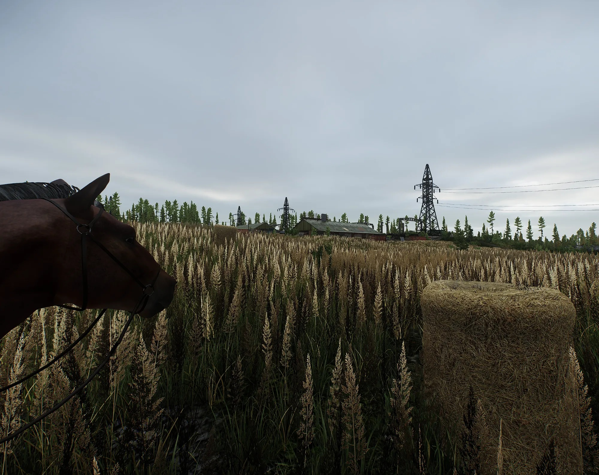

# Shoreline Hay Field (SPT 4.1)



A hay field in the open meadow by the smugglers' base on Shoreline (north-east corner, inside the fence,
centred at x -575, z -115, 120 x 90 m by default). Standing dry grass covers it, with 44 round bales
(Shoreline's own Hay_new prop, about 40% rolled on their side) spread evenly through it, the hay cleared around each one.
Everything stays inside the meadow's fence. Raise "Mown share" for a strip of mown stubble. The outline is irregular, and grass, stubble and bales skip buildings, the plane wreck, pylons,
rocks and steep ground. The bales block movement and bullets (EFT material GrassHigh, partly penetrable).

Built at raid start; ships no game files. The standing grass uses EFT's own `grass6_d_02_autumn_late` texture,
loaded from your install; the straw textures are generated.

## Install
Requires SPT 4.1 (BepInEx). Unzip the release into your SPT folder (the one with `EscapeFromTarkov.exe`).
It puts `ShorelineHayField.dll` in `BepInEx/plugins/ShorelineHayField/`. Client only; no server mod.

## Settings (F12 > ShorelineHayField)
- Position, rotation, size, grass density, number of round bales, layout seed. Changes rebuild the field live.
- **Ctrl+Shift+H** in raid moves the field to just ahead of you, facing your view, and saves the position.

## Notes
- Bots don't know the bales are there (no navmesh change); they may walk into them.
- Fika: every client (and the headless) needs the plugin with the same settings, or the bales only exist for some players.
- Log lines start with `[ShorelineHayField]` in `BepInEx/LogOutput.log`, including which shaders it picked.

## Build
Point the build at your SPT install with `plugin/local.props` (not committed):
```xml
<Project>
  <PropertyGroup>
    <SPTPath>D:\SPT</SPTPath>
  </PropertyGroup>
</Project>
```
or pass `-p:SPTPath=...`. Then:
```
dotnet build plugin -c Release -o plugin/out
```
Copy `plugin/out/ShorelineHayField.dll` to `BepInEx/plugins/ShorelineHayField/`.

## Credits
- The hay bale model and the dry grass texture are Battlestate Games' Shoreline assets. The mod ships none of them: it
  reuses the hay prop already loaded on Shoreline and reads the grass texture from your own install at raid start.
- Built with AI assistance (Claude Code).

## License
MIT (see `LICENSE`). It covers this mod's code only, not Battlestate Games' assets.
